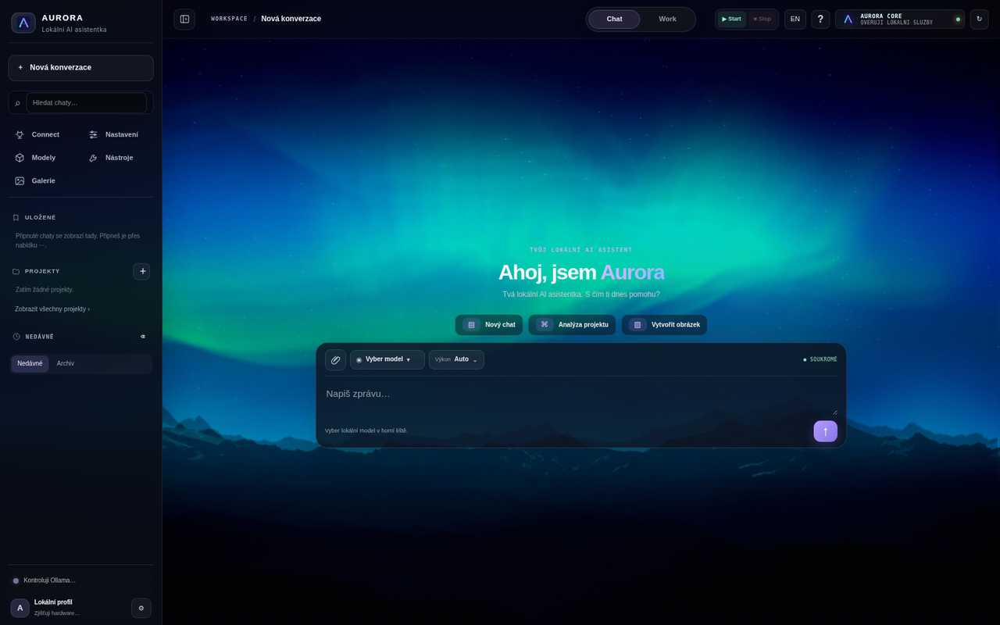
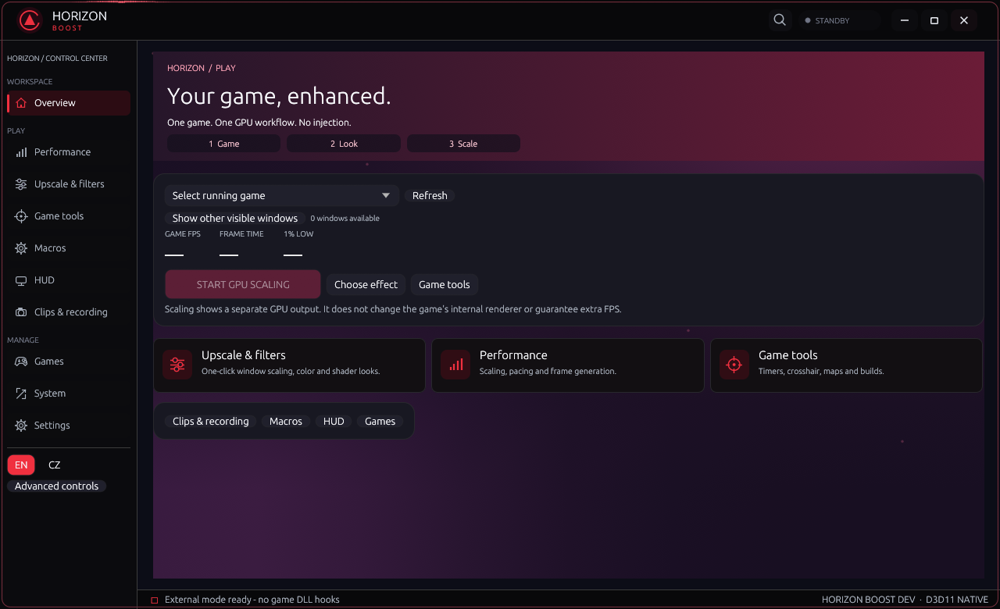

# SAMUS // PROJECTS

**Aurora AI · Horizon Boost · Thalvoryn Worldgen**

[**Project Website**](https://samus-18.github.io/samus-project-hub/) · [**All Releases**](https://github.com/Samus-18/samus-project-hub/releases)

A public home for projects by Samus-18. Independent AI, Windows GPU software and Minecraft world generation.

## Featured projects

### Aurora AI v0.8.6

A local-first Windows AI assistant with Ollama, optional cloud providers, a unified Chat/Work workspace, Agent Studio, ComfyUI and guarded developer integrations.

[Source](projects/aurora-ai/) · [Latest Release](https://github.com/Samus-18/samus-project-hub/releases/tag/aurora-ai-v0.8.6)

### Horizon Boost V135 developer preview

Native Rust gaming tools: Windows.Graphics.Capture, D3D11 filtering, independent DXGI output, upscaling, overlays and utilities. Not a Magpie wrapper; no game DLL injection.

[Source](projects/horizon-boost/) · [Latest Development Release](https://github.com/Samus-18/samus-project-hub/releases/tag/horizon-boost-v135-dev)

### Thalvoryn Worldgen V86 Stage 3 TEST

Minecraft Java and Horizon Rust world generation, with different Nether heights (1024 / 2032), JJThunder-inspired terrain and TREK structures.

[Details and License Review](projects/thalvoryn/) · [Release Status](https://github.com/Samus-18/samus-project-hub/releases/tag/thalvoryn-v86-stage3-review)

## What is public

- The responsive GitHub Pages website lives under docs/.
- Aurora AI: a lean source snapshot, current changelog, tests and build scripts. No node_modules or generated installers in Git.
- Horizon Boost: Rust code, shaders, selected app assets, manifest and third-party notices. Magpie binaries and machine-local toolchains are excluded.
- Thalvoryn: current test ZIP metadata, SHA-256 values, pack icon, original credits and rights review; no uncertain third-party NBT is redistributed.

**Development build is not a guarantee of compatibility.** Tests, screenshots and SHA-256 information are shown in release notes. A binary upload is held if its original redistribution permissions are unresolved.

## Release process

Every new project version should receive its own tag and release. Source code, exact version, checksums, limitations and website information must stay synchronized. See [AGENTS.md](AGENTS.md) and [Release Policy](tools/RELEASE_POLICY.md).

No private chat history, credential files or AI memory archives are included. Public visibility does not override third-party copyright licenses.
