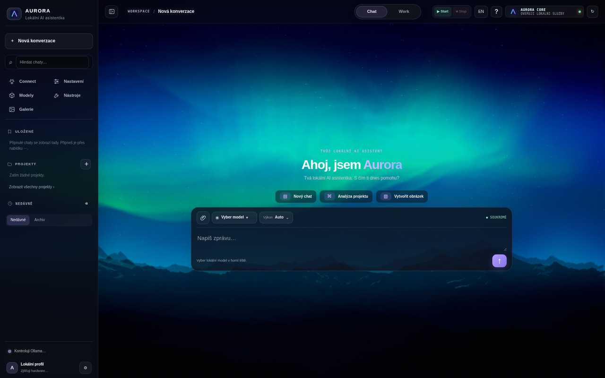

# Aurora AI v0.8.6

Local-first Electron desktop AI assistant for Windows. Features Ollama model selection, optional OpenAI-compatible, Anthropic and Gemini provider APIs, a shared Chat/Work layout, Agent Studio, local memory and ComfyUI support. Includes explicit approval for project edits and project-tool execution.

## Windows installation

The real NSIS installer Aurora-AI-Setup-0.8.6.exe was recovered from the local dist directory and its SHA-256 matches the recorded verification file. Download from [Release v0.8.6](https://github.com/Samus-18/samus-project-hub/releases/tag/aurora-ai-v0.8.6). The installer may be unsigned; live provider functionality and Windows integration remain unverified.

## Build from source

Requires Windows and Node.js 22.12 or newer (Node 24 LTS recommended).

1. npm ci
2. npm run check
3. npm test
4. npm run release:preflight
5. npm run dist (or START-BUILD-AURORA.bat to build setup)

Configure local Ollama at 127.0.0.1:11434, and optionally ComfyUI at 127.0.0.1:8188. API keys are user-owned and are not shipped.

## Source cleanup

The public copy contains current src/, integrations/, scripts/, tests/, current packaging files and the latest changelog. Removed from the PUBLIC COPY only: node_modules, compiled installers, logs, duplicate old audits/changelogs, obsolete screenshots and personal shortcuts. Original local project is preserved.

Static Chromium screenshots use demonstration data; they do not prove a live connection to a model or editor. See AUDIT-CZ-v0.8.6.md and RELEASE-CHECKLIST-CZ.md.
