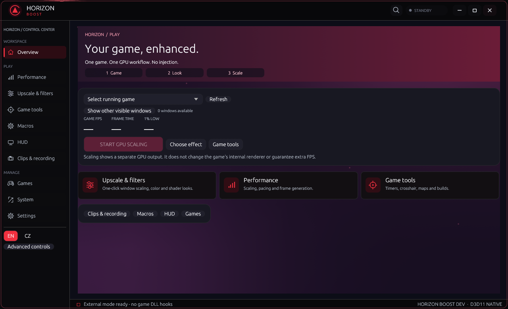

# Horizon Boost V135 — Rust GPU utilities

Windows-native GPU gaming utility developed in Rust, without injecting into a game process. Uses Windows.Graphics.Capture (WGC), native D3D11 compute shaders and independent DXGI flip output, plus optional scaling, filters, profiles, HUD tools and experimental frame generation.

## V135 DXGI output reliability

- **558/558 Rust unit tests passed**; two live WGC integration fixtures intentionally ignored.
- Windows GUI EXE build, packager self-test and 3 read-only headless CLI operations passed.
- Fixed DXGI Desktop Duplication fallback: only S_OK from Present counts toward real own-output FPS. Occluded and busy/non-submitted statuses update diagnostics and reset frame deadlines; device reset/error still follows existing recovery. Three additional regression tests.
- Retains V134 fix to false monitor-change rebuilds; handles actual selected-game monitor move/resize/disconnect.

### Verification limits

This is a **developer prerelease**. Not proven: live Minecraft/Roblox mouse remapping, true-exclusive fullscreen across every game engine, or a Magpie speed advantage. Own output FPS is not game-engine FPS and DXGI Present submission is not guaranteed physical display scanout.

## Public source and licensing

The repository includes selected Rust sources and GPU shaders, with local toolchain, private logs, previous builds and Magpie executables excluded. GPLv3-derived FSRCNNX/CuNNy shaders in the packaged developer ZIP are distributed with their corresponding source and notices. No game injection.

[Download the V135 developer ZIP and SHA-256](https://github.com/Samus-18/samus-project-hub/releases/tag/horizon-boost-v135-dev)
