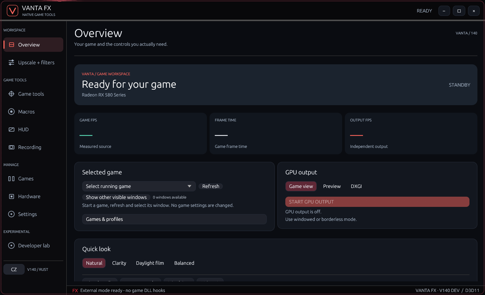

# Vanta FX V140

Native Windows Rust GPU tools and local recording utilities.

- Native GPU effects, upscaling, own WGC/DXGI output and experimental frame generation.
- Hardware scan and reversible Vanta profile backups; real game and output FPS distinguished.
- TinyTask-style macro transport controls and optional advanced timeline, hotkey and raw relative input settings.
- Movable interactive macro overlay with record/play/stop, opt-in continuous loop; separate FPS HUD.
- Macro replay is for permitted local/offline applications. No game injection or anti-cheat bypass.

571 Rust tests passed, two GPU tests ignored. Hidden native GUI screenshots and read-only CLI verified. Game-specific camera replay, exclusive fullscreen, performance and anti-cheat compatibility are unverified. Windows build is unsigned. Full source and license notices included.
